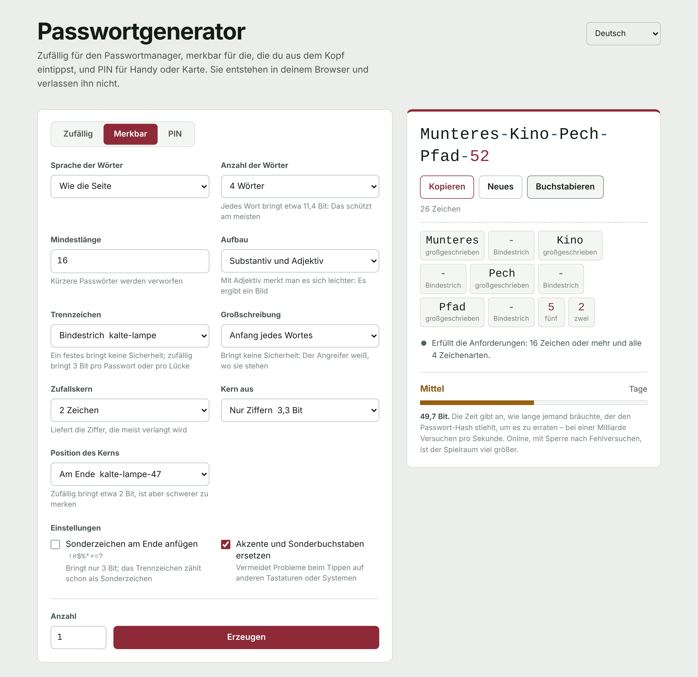

[Español](README.md) | [English](README.en.md) | [Français](README.fr.md) | [Português](README.pt.md) | **Deutsch** | [Italiano](README.it.md)

# Passwortgenerator

Ein Passwortgenerator, der vollständig im Browser läuft. Er besteht aus einer einzigen HTML-Datei: kein Server, keine Abhängigkeiten und keine Verbindungen nach außen. Die Passwörter entstehen auf deinem Gerät und verlassen es nicht.

**Online nutzen:** https://pw.linvx.org



## Was er kann

**Drei Modi**

- **Zufällig**, für alles, was der Passwortmanager speichert. 6 bis 64 Zeichen (standardmäßig 50), wahlweise mit Klein- und Großbuchstaben, Ziffern und Sonderzeichen, auf Wunsch ohne leicht verwechselbare Zeichen (`i I 1 l L o O 0`).
- **Merkbar**, für die Passwörter, die du selbst eintippst: Computer, E-Mail oder das Hauptpasswort des Passwortmanagers. Zufällige Wörter mit korrekter Deklination (`Kalte-Lampe-Zug-Komet-47`), mit einstellbarem Trennzeichen, Großschreibung und Ziffernkern.
- **PIN**, für Handy, Karte oder Alarmanlage. 4 bis 12 Ziffern, ohne die, die zuerst ausprobiert werden: Wiederholungen (`0000`, `1212`), Folgen (`1234`, `9876`), Jahre und Datumsangaben in jedem Format (`1985`, `0712`, `19850712`) sowie Spalten und Diagonalen des Tastenfelds (`2580`, `1379`).

**Sechs Sprachen**, in der Oberfläche und in den Wörterbüchern: Spanisch, Englisch, Französisch, Portugiesisch, Deutsch und Italienisch. Jedes Wörterbuch enthält rund 2.300 Substantive und 500 Adjektive, nach Häufigkeit gefiltert und von Hand geprüft, um anstößige oder zweideutige Wörter zu entfernen und solche, die ohne Umlaute zu etwas anderem werden.

**Außerdem**

- Prüft das Passwort gegen eine Richtlinie für Länge und Zeichenarten (standardmäßig 16 Zeichen und alle 4 Arten) und sagt, was fehlt.
- Zeigt die Stärke in Bit, unter der Annahme, dass der Angreifer Verfahren und Wörterbuch kennt, und schätzt, wie lange das Erraten bei einer Milliarde Versuchen pro Sekunde dauern würde.
- **Buchstabieren** zum Diktieren: jedes Zeichen mit seinem Namen („M groß“, „7 sieben“, „# Raute“) oder, bei merkbaren Passwörtern, jedes ganze Wort.
- Ziffern und Sonderzeichen erscheinen in eigener Farbe, damit `0` und `O` oder `1` und `l` nicht verwechselt werden.
- Bis zu 200 Passwörter auf einmal.
- Helles und dunkles Design je nach System; funktioniert auf dem Handy.

## Sicherheit

- **Kryptografischer Zufall.** Alles stammt aus `crypto.getRandomValues`. Werte, die eine Verzerrung erzeugen würden, werden verworfen, sodass kein Zeichen und kein Wort häufiger vorkommt als ein anderes.
- **Wirklich gleichverteilt.** Der Zufallsmodus reserviert keinen Platz pro Zeichenart (das übliche Verfahren, das zu viele Ziffern und Sonderzeichen erzeugt): Er zieht das ganze Passwort und verwirft es, wenn eine Art fehlt. Ebenso bei vorhersehbaren PINs. Die angezeigten Bit zählen nur gültige Passwörter.
- **Nichts verlässt den Browser.** Die Seite stellt keine Netzwerkanfragen. Ihre `Content-Security-Policy` beginnt mit `default-src 'none'` und führt nur die Skripte und das Stylesheet aus, deren SHA-256-Hash übereinstimmt: Es lässt sich kein Code einschleusen und nichts von außen laden.
- **Keine gespeicherten Passwörter.** Gespeichert werden nur die Formulareinstellungen, im lokalen Speicher des Browsers. Nach dem Neuladen sind die Passwörter weg.
- **Lesbarer Code.** Weder verschleiert noch minimiert: Öffne `index.html` und prüfe alles oben Gesagte selbst.

## Offline nutzen

Lade `index.html` herunter und öffne sie im Browser. Sie funktioniert genauso wie online, auch ohne Internet.

## Prüfen, ob sie verändert wurde

Der SHA-256-Hash von `index.html` ändert sich bei jeder noch so kleinen Änderung. So vergleichst du die veröffentlichte Version mit der im Repository:

```bash
curl -s https://pw.linvx.org | sha256sum
sha256sum index.html
```

Unter Windows: `Get-FileHash index.html`.

## Was ein gutes Passwort nicht löst

- Wiederverwendung: Ein Passwort auf zwei Seiten ist nur so stark wie die schwächere der beiden.
- Die Eingabe auf einer gefälschten Seite.
- Die Zwischenablage: Kopiertes bleibt dort, und mit aktiviertem Verlauf oder Synchronisierung wird es gespeichert.
- Browsererweiterungen, die jede Seite lesen können.

Was wirklich zählt, sind Zwei-Faktor-Authentifizierung, ein eigenes Passwort pro Dienst und ein Passwortmanager.

## Lizenz

[GPL-3.0](LICENSE)
