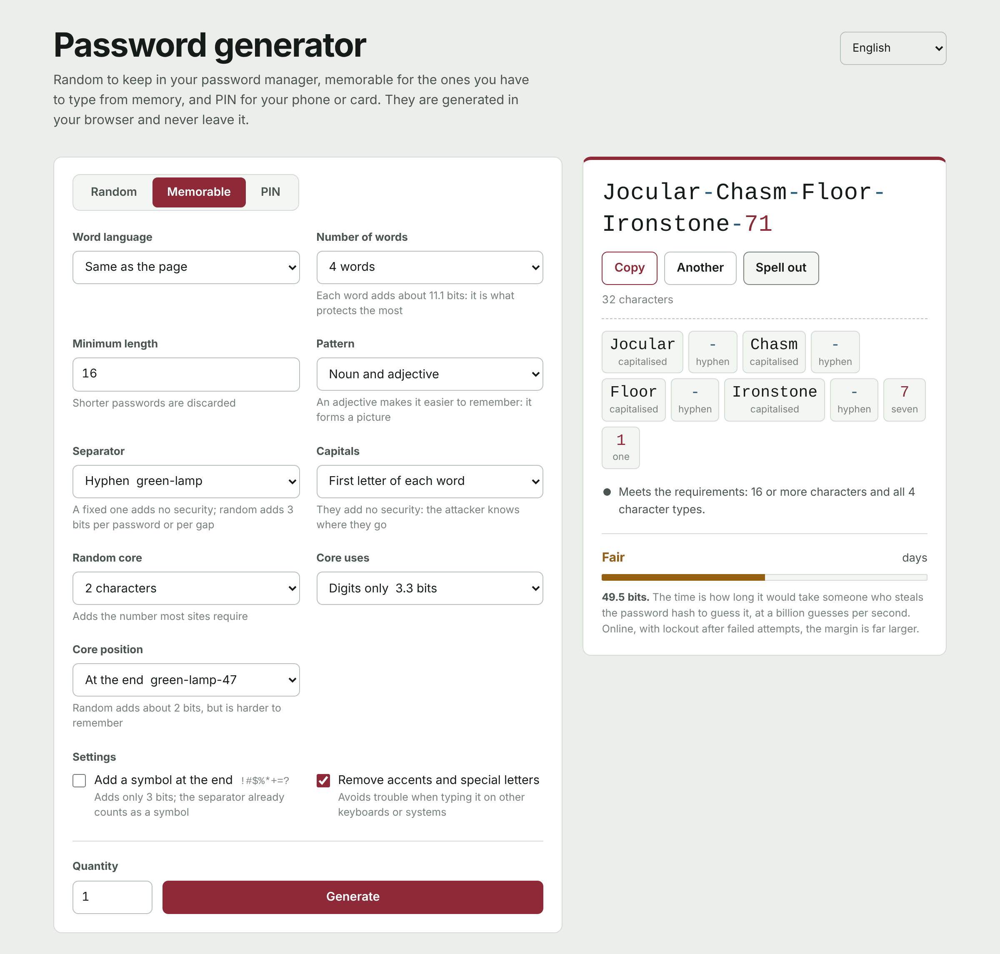

[Español](README.md) | **English** | [Français](README.fr.md) | [Português](README.pt.md) | [Deutsch](README.de.md) | [Italiano](README.it.md)

# Password generator

A password generator that runs entirely in the browser. It is a single HTML file: no server, no dependencies and no connections to anywhere. Passwords are created on your device and never leave it.

**Use it online:** https://generaclaves.lubricantes-sash.com



## What it does

**Three modes**

- **Random**, for everything your password manager stores. From 6 to 64 characters (50 by default), choosing lowercase, uppercase, digits and symbols, with an option to leave out look-alike characters (`i I 1 l L o O 0`).
- **Memorable**, for the ones you type yourself: your computer, your email or your password manager's master password. Random words with grammatical agreement (`Dry-Lamp-Train-Comet-47`), with configurable separator, capitals and a core of random digits.
- **PIN**, for your phone, card or alarm. From 4 to 12 digits, discarding the ones attackers try first: repeats (`0000`, `1212`), sequences (`1234`, `9876`), years and dates in any format (`1985`, `0712`, `19850712`) and keypad columns and diagonals (`2580`, `1379`).

**Six languages**, in the interface and in the word lists: Spanish, English, French, Portuguese, German and Italian. Each list has about 2,300 nouns and 500 adjectives, filtered by word frequency and checked by hand to remove offensive words, double meanings and words that turn into something else once accents are removed.

**Also**

- Checks the password against a length and character-type policy (16 characters and all 4 types by default) and, if it fails, says why.
- Shows strength in bits, assuming the attacker knows the method and the word list, and estimates how long guessing it would take at a billion guesses per second.
- **Spelling** to read it out: each character with its name ("M capital", "7 seven", "# hash") or, for memorable passwords, each whole word.
- Digits and symbols are shown in their own colour, so `0` and `O` or `1` and `l` are not confused.
- Batches of up to 200 passwords at once.
- Light and dark theme following the system; works on phones.

## Security

- **Cryptographic randomness.** Everything comes from `crypto.getRandomValues`. Numbers are drawn discarding values that would cause bias, so no character or word comes up more often than another.
- **Truly uniform.** Random mode does not reserve a slot for each character type (the usual approach, which produces too many digits and symbols): it draws the whole password and discards it if a type is missing. The same goes for predictable PINs. The bits shown on the page count valid passwords only.
- **Nothing leaves the browser.** The page makes no network requests. Its `Content-Security-Policy` starts from `default-src 'none'` and only runs the scripts and the stylesheet whose SHA-256 hash matches: code cannot be injected and nothing can be loaded from elsewhere.
- **No passwords stored.** Only the form settings are remembered, in the browser's local storage. Reload and the passwords are gone.
- **Readable code.** It is neither obfuscated nor minified: open `index.html` and check all of the above.

## Using it offline

Download `index.html` and open it in your browser. It works exactly as online, even without internet.

## Checking it has not changed

The SHA-256 hash of `index.html` changes with any modification, however small. To compare the published version with the one in the repository:

```bash
curl -s https://generaclaves.lubricantes-sash.com/ | sha256sum
sha256sum index.html
```

On Windows: `Get-FileHash index.html`.

## What a good password does not fix

- Reuse: a password used on two sites is only as strong as the weaker of the two.
- Typing it into a fake page.
- The clipboard: what you copy stays there, and if clipboard history or sync is on, it is saved.
- Browser extensions, which can read any page.

What really makes the difference is two-factor authentication, a different password for each service and a password manager.

## Licence

[GPL-3.0](LICENSE)
