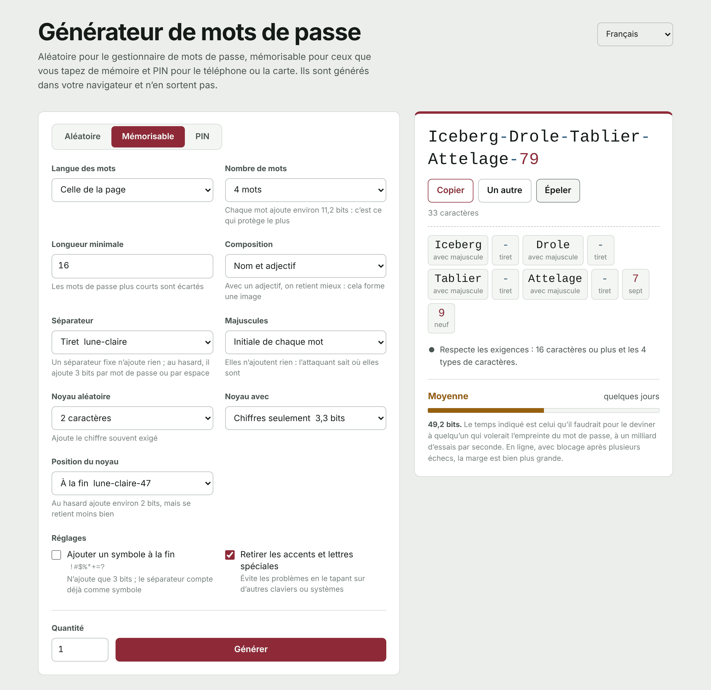

[Español](README.md) | [English](README.en.md) | **Français** | [Português](README.pt.md) | [Deutsch](README.de.md) | [Italiano](README.it.md)

# Générateur de mots de passe

Un générateur de mots de passe qui fonctionne entièrement dans le navigateur. C'est un seul fichier HTML : pas de serveur, pas de dépendances et aucune connexion vers l'extérieur. Les mots de passe naissent sur votre appareil et n'en sortent pas.

**L'utiliser en ligne :** https://generaclaves.lubricantes-sash.com



## Ce qu'il fait

**Trois modes**

- **Aléatoire**, pour tout ce que garde le gestionnaire de mots de passe. De 6 à 64 caractères (50 par défaut), au choix minuscules, majuscules, chiffres et symboles, avec l'option d'écarter les caractères qui se confondent (`i I 1 l L o O 0`).
- **Mémorisable**, pour ceux que vous tapez vous-même : celui de l'ordinateur, de la messagerie ou le mot de passe maître du gestionnaire. Des mots au hasard qui s'accordent en genre (`Lune-Claire-Train-Comete-47`), avec séparateur, majuscules et noyau de chiffres réglables.
- **PIN**, pour le téléphone, la carte ou l'alarme. De 4 à 12 chiffres, en écartant ceux que l'on essaie en premier : répétitions (`0000`, `1212`), suites (`1234`, `9876`), années et dates sous toutes leurs formes (`1985`, `0712`, `19850712`) et colonnes et diagonales du clavier (`2580`, `1379`).

**Six langues**, dans l'interface et dans les dictionnaires : espagnol, anglais, français, portugais, allemand et italien. Chaque dictionnaire compte environ 2 300 noms et 500 adjectifs, filtrés par fréquence d'usage et revus à la main pour retirer les mots grossiers, à double sens ou qui deviennent autre chose une fois les accents retirés.

**En plus**

- Vérifie que le mot de passe respecte une politique de longueur et de types de caractères (16 caractères et les 4 types, par défaut) et, sinon, explique ce qui manque.
- Calcule la robustesse en bits en supposant que l'attaquant connaît la méthode et le dictionnaire, et estime le temps qu'il lui faudrait à un milliard d'essais par seconde.
- **Épellation** pour le dicter : chaque caractère avec son nom (« M majuscule », « 7 sept », « # dièse ») ou, pour les mémorisables, chaque mot entier.
- Les chiffres et les symboles s'affichent dans une autre couleur, pour ne pas confondre `0` et `O` ni `1` et `l`.
- Lots de jusqu'à 200 mots de passe à la fois.
- Thème clair et sombre selon le système ; fonctionne sur mobile.

## Sécurité

- **Hasard cryptographique.** Tout vient de `crypto.getRandomValues`. Les tirages écartent les valeurs qui introduiraient un biais : aucun caractère ni aucun mot ne sort plus souvent qu'un autre.
- **Vraiment uniforme.** Le mode aléatoire ne réserve pas une place à chaque type de caractère (la méthode habituelle, qui fait sortir trop de chiffres et de symboles) : il tire le mot de passe entier et le rejette s'il manque un type. De même pour les PIN prévisibles. Les bits affichés ne comptent que les mots de passe valides.
- **Rien ne sort du navigateur.** La page ne fait aucune requête réseau. Sa politique de sécurité (`Content-Security-Policy`) part de `default-src 'none'` et n'exécute que les scripts et la feuille de style dont l'empreinte SHA-256 correspond : impossible d'injecter du code ou de charger quoi que ce soit d'ailleurs.
- **Aucun mot de passe enregistré.** Seuls les réglages du formulaire sont mémorisés, dans le stockage local du navigateur. Au rechargement, les mots de passe disparaissent.
- **Code lisible.** Ni obscurci ni compressé : ouvrez `index.html` et vérifiez tout ce qui précède.

## L'utiliser hors ligne

Téléchargez `index.html` et ouvrez-le dans votre navigateur. Il fonctionne comme en ligne, même sans internet.

## Vérifier qu'il n'a pas changé

L'empreinte SHA-256 de `index.html` change à la moindre modification. Pour comparer la version publiée à celle du dépôt :

```bash
curl -s https://generaclaves.lubricantes-sash.com/ | sha256sum
sha256sum index.html
```

Sous Windows : `Get-FileHash index.html`.

## Ce qu'un bon mot de passe ne règle pas

- La réutilisation : un mot de passe utilisé sur deux sites ne vaut pas mieux que le plus faible des deux.
- Le saisir sur une fausse page.
- Le presse-papiers : ce que vous copiez y reste et, si l'historique ou la synchronisation est activé, il est enregistré.
- Les extensions du navigateur, qui peuvent lire n'importe quelle page.

Ce qui change vraiment la donne, c'est la double authentification, un mot de passe différent par service et un gestionnaire de mots de passe.

## Licence

[GPL-3.0](LICENSE)
