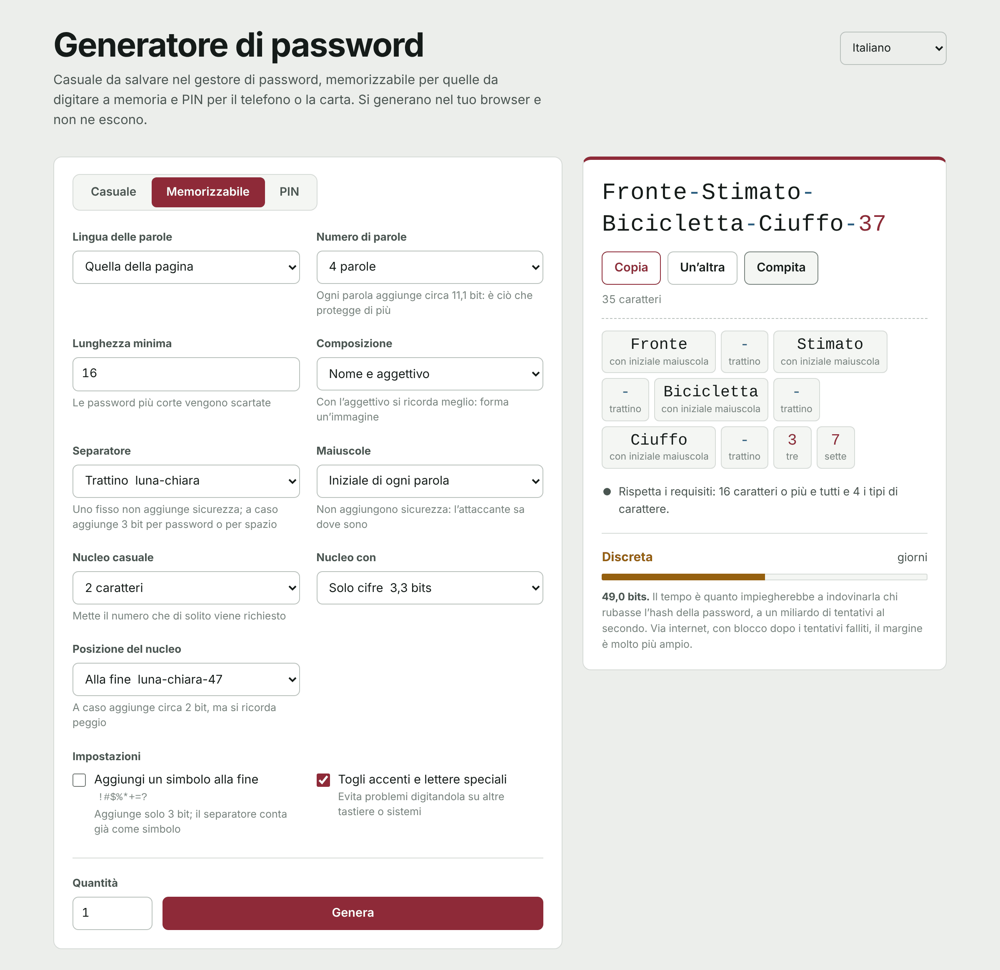

[Español](README.md) | [English](README.en.md) | [Français](README.fr.md) | [Português](README.pt.md) | [Deutsch](README.de.md) | **Italiano**

# Generatore di password

Un generatore di password che funziona interamente nel browser. È un unico file HTML: niente server, niente dipendenze e nessuna connessione verso l'esterno. Le password nascono sul tuo dispositivo e non ne escono.

**Usalo online:** https://generaclaves.lubricantes-sash.com



## Cosa fa

**Tre modalità**

- **Casuale**, per tutto ciò che conserva il gestore di password. Da 6 a 64 caratteri (50 di default), scegliendo minuscole, maiuscole, cifre e simboli, con l'opzione di escludere i caratteri che si confondono (`i I 1 l L o O 0`).
- **Memorizzabile**, per quelle che digiti tu: quella del computer, della posta o la password principale del gestore. Parole a caso concordate nel genere (`Luna-Chiara-Treno-Cometa-47`), con separatore, maiuscole e nucleo di cifre configurabili.
- **PIN**, per il telefono, la carta o l'allarme. Da 4 a 12 cifre, scartando quelli che si provano per primi: ripetizioni (`0000`, `1212`), sequenze (`1234`, `9876`), anni e date in qualsiasi formato (`1985`, `0712`, `19850712`) e colonne e diagonali del tastierino (`2580`, `1379`).

**Sei lingue**, nell'interfaccia e nei dizionari: spagnolo, inglese, francese, portoghese, tedesco e italiano. Ogni dizionario ha circa 2.300 sostantivi e 500 aggettivi, filtrati per frequenza d'uso e rivisti a mano per togliere parole volgari, a doppio senso o che senza accenti diventano un'altra cosa.

**Inoltre**

- Controlla che la password rispetti una politica di lunghezza e tipi di carattere (16 caratteri e tutti e 4 i tipi, di default) e, se non la rispetta, spiega cosa manca.
- Calcola la robustezza in bit supponendo che l'attaccante conosca il metodo e il dizionario, e stima quanto ci vorrebbe per indovinarla a un miliardo di tentativi al secondo.
- **Compitazione** per dettarla: ogni carattere con il suo nome («M maiuscola», «7 sette», «# cancelletto») o, nelle memorizzabili, ogni parola intera.
- Cifre e simboli compaiono in un altro colore, per non confondere `0` con `O` né `1` con `l`.
- Fino a 200 password alla volta.
- Tema chiaro e scuro secondo il sistema; funziona sul telefono.

## Sicurezza

- **Casualità crittografica.** Tutto viene da `crypto.getRandomValues`. Le estrazioni scartano i valori che introdurrebbero distorsioni, quindi nessun carattere o parola esce più spesso di un altro.
- **Davvero uniforme.** La modalità casuale non riserva un posto a ogni tipo di carattere (il metodo abituale, che fa uscire troppe cifre e simboli): estrae l'intera password e la scarta se manca un tipo. Lo stesso per i PIN prevedibili. I bit mostrati contano solo le password valide.
- **Niente esce dal browser.** La pagina non fa nessuna richiesta di rete. La sua politica di sicurezza (`Content-Security-Policy`) parte da `default-src 'none'` ed esegue solo gli script e il foglio di stile la cui impronta SHA-256 corrisponde: non si può iniettare codice né caricare nulla dall'esterno.
- **Nessuna password salvata.** Ricorda solo le impostazioni del modulo, nella memoria locale del browser. Ricaricando, le password spariscono.
- **Codice leggibile.** Né offuscato né compresso: apri `index.html` e verifica tutto quanto sopra.

## Usarlo offline

Scarica `index.html` e aprilo nel browser. Funziona come online, anche senza internet.

## Verificare che non sia cambiato

L'impronta SHA-256 di `index.html` cambia con qualsiasi modifica, anche minima. Per confrontare la versione pubblicata con quella del repository:

```bash
curl -s https://generaclaves.lubricantes-sash.com/ | sha256sum
sha256sum index.html
```

Su Windows: `Get-FileHash index.html`.

## Cosa non risolve una buona password

- Riutilizzarla: una password usata su due siti vale quanto il più debole dei due.
- Digitarla in una pagina falsa.
- Gli appunti: ciò che copi resta lì e, se la cronologia o la sincronizzazione degli appunti è attiva, viene salvato.
- Le estensioni del browser, che possono leggere qualsiasi pagina.

Ciò che fa davvero la differenza è l'autenticazione a due fattori, una password diversa per ogni servizio e un gestore di password.

## Licenza

[GPL-3.0](LICENSE)
