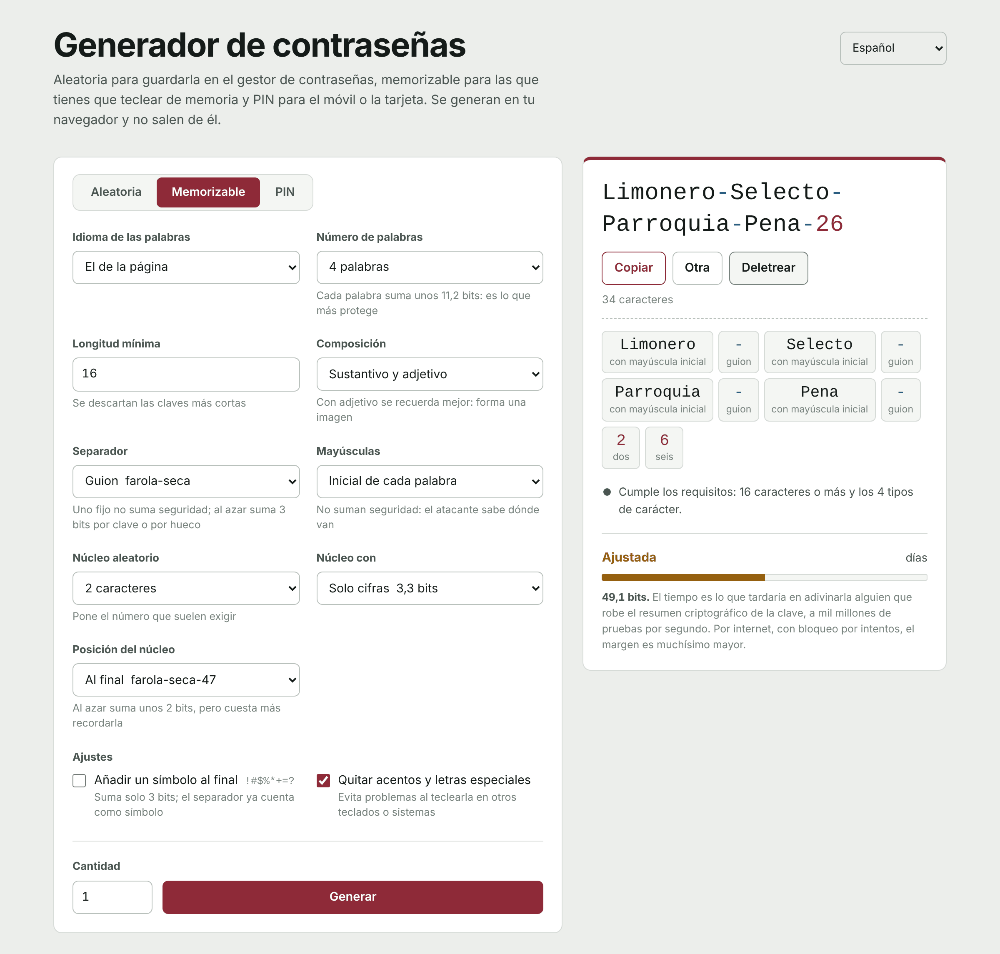

**Español** | [English](README.en.md) | [Français](README.fr.md) | [Português](README.pt.md) | [Deutsch](README.de.md) | [Italiano](README.it.md)

# Generador de contraseñas

Un generador de contraseñas que funciona entero en el navegador. Es un único archivo HTML: sin servidor, sin dependencias y sin conexiones a ningún sitio. Las contraseñas nacen en tu equipo y no salen de él.

**Úsalo en línea:** https://generaclaves.lubricantes-sash.com



## Qué hace

**Tres modos**

- **Aleatoria**, para todo lo que guarda el gestor de contraseñas. De 6 a 64 caracteres (50 por defecto), eligiendo minúsculas, mayúsculas, cifras y símbolos, con opción de quitar los caracteres que se confunden (`i I 1 l L o O 0`).
- **Memorizable**, para las que tecleas tú: la del ordenador, la del correo o la maestra del gestor. Palabras al azar que concuerdan en género (`Farola-Seca-Tren-Cometa-47`), con separador, mayúsculas y un núcleo de cifras configurables.
- **PIN**, para el móvil, la tarjeta o la alarma. De 4 a 12 cifras, descartando las que se prueban primero: repeticiones (`0000`, `1212`), secuencias (`1234`, `9876`), años y fechas en cualquier formato (`1985`, `0712`, `19850712`) y columnas y diagonales del teclado (`2580`, `1379`).

**Seis idiomas**, en la interfaz y en los diccionarios: español, inglés, francés, portugués, alemán e italiano. Cada diccionario tiene unos 2.300 sustantivos y 500 adjetivos, filtrados por frecuencia de uso y revisados a mano para quitar palabras malsonantes, de doble sentido o que al quitar las tildes se convierten en otra cosa.

**Además**

- Comprueba si la contraseña cumple una política de longitud y tipos de carácter (16 caracteres y los 4 tipos, por defecto) y, si no, dice qué falla.
- Calcula la seguridad en bits suponiendo que el atacante conoce el método y el diccionario, y estima cuánto tardaría en adivinarla con mil millones de pruebas por segundo.
- **Deletreo** para dictarla: cada carácter con su nombre («M mayúscula», «7 siete», «# almohadilla») o, en las memorizables, cada palabra entera.
- Las cifras y los símbolos salen en otro color, para no confundir `0` con `O` ni `1` con `l`.
- Lotes de hasta 200 contraseñas a la vez.
- Tema claro y oscuro según el sistema; funciona en el móvil.

## Seguridad

- **Azar criptográfico.** Todo sale de `crypto.getRandomValues`. Los números se sortean descartando los que causarían sesgo, así que ningún carácter ni palabra sale más que otro.
- **Uniforme de verdad.** En el modo aleatorio no se reserva un hueco para cada tipo de carácter (lo habitual, que hace salir más cifras y símbolos de la cuenta): se sortea la clave entera y se descarta si falta algún tipo. Lo mismo con los PIN previsibles. Los bits que muestra la página cuentan solo las claves válidas.
- **Nada sale del navegador.** La página no hace ninguna petición de red. Su política de seguridad (`Content-Security-Policy`) parte de `default-src 'none'` y solo deja ejecutar los programas y la hoja de estilo cuya huella SHA-256 coincide: no se puede inyectar código ni cargar nada de fuera.
- **No guarda contraseñas.** Solo recuerda los ajustes del formulario, en el almacenamiento local del navegador. Al recargar, las contraseñas desaparecen.
- **Código legible.** No está ofuscado ni comprimido: puedes abrir `index.html` y comprobar todo lo anterior.

## Usarlo sin conexión

Descarga `index.html` y ábrelo con el navegador. Funciona igual que en línea, incluso sin internet.

## Comprobar que no ha cambiado

La huella SHA-256 de `index.html` cambia con cualquier modificación, por pequeña que sea. Para comparar la versión publicada con la del repositorio:

```bash
curl -s https://generaclaves.lubricantes-sash.com/ | sha256sum
sha256sum index.html
```

En Windows: `Get-FileHash index.html`.

## Lo que no arregla una buena contraseña

- Repetirla: una clave usada en dos sitios vale lo que el más débil de los dos.
- Escribirla en una página falsa.
- El portapapeles: lo copiado se queda ahí, y si tienes activado el historial o la sincronización del portapapeles, se guarda.
- Las extensiones del navegador, que pueden leer cualquier página.

Lo que de verdad cambia el resultado es la verificación en dos pasos, una contraseña distinta por servicio y un gestor de contraseñas.

## Licencia

[GPL-3.0](LICENSE)
