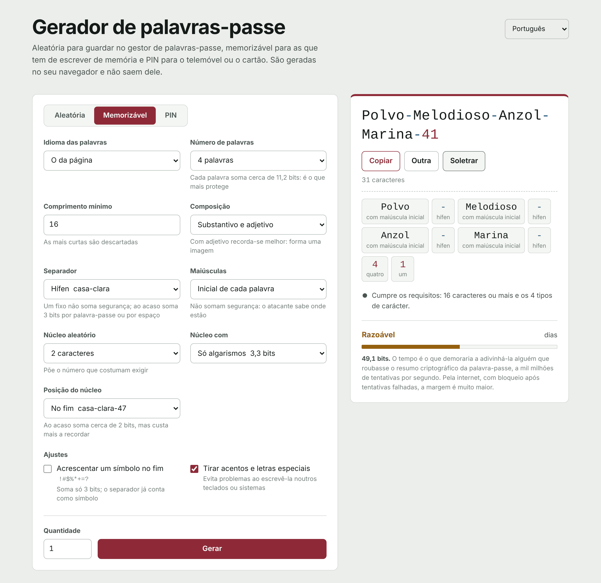

[Español](README.md) | [English](README.en.md) | [Français](README.fr.md) | **Português** | [Deutsch](README.de.md) | [Italiano](README.it.md)

# Gerador de palavras-passe

Um gerador de palavras-passe que funciona inteiramente no navegador. É um único ficheiro HTML: sem servidor, sem dependências e sem ligações a lado nenhum. As palavras-passe nascem no seu equipamento e não saem dele.

**Usar online:** https://generaclaves.lubricantes-sash.com



## O que faz

**Três modos**

- **Aleatória**, para tudo o que o gestor de palavras-passe guarda. De 6 a 64 caracteres (50 por omissão), escolhendo minúsculas, maiúsculas, algarismos e símbolos, com opção de excluir os caracteres que se confundem (`i I 1 l L o O 0`).
- **Memorizável**, para as que escreve à mão: a do computador, a do correio ou a mestra do gestor. Palavras ao acaso que concordam em género (`Casa-Clara-Comboio-Cometa-47`), com separador, maiúsculas e um núcleo de algarismos configuráveis.
- **PIN**, para o telemóvel, o cartão ou o alarme. De 4 a 12 algarismos, descartando os que se experimentam primeiro: repetições (`0000`, `1212`), sequências (`1234`, `9876`), anos e datas em qualquer formato (`1985`, `0712`, `19850712`) e colunas e diagonais do teclado (`2580`, `1379`).

**Seis idiomas**, na interface e nos dicionários: espanhol, inglês, francês, português, alemão e italiano. Cada dicionário tem cerca de 2300 substantivos e 500 adjetivos, filtrados pela frequência de uso e revistos à mão para retirar palavras ofensivas, de duplo sentido ou que se transformam noutra coisa ao retirar os acentos.

**Além disso**

- Verifica se a palavra-passe cumpre uma política de comprimento e tipos de carácter (16 caracteres e os 4 tipos, por omissão) e, se não cumprir, diz o que falha.
- Calcula a segurança em bits supondo que o atacante conhece o método e o dicionário, e estima quanto tempo demoraria a adivinhá-la a mil milhões de tentativas por segundo.
- **Soletração** para a ditar: cada carácter com o seu nome («M maiúscula», «7 sete», «# cardinal») ou, nas memorizáveis, cada palavra inteira.
- Os algarismos e os símbolos aparecem noutra cor, para não confundir `0` com `O` nem `1` com `l`.
- Lotes de até 200 palavras-passe de uma vez.
- Tema claro e escuro conforme o sistema; funciona no telemóvel.

## Segurança

- **Aleatoriedade criptográfica.** Tudo vem de `crypto.getRandomValues`. Os sorteios descartam os valores que causariam enviesamento, por isso nenhum carácter ou palavra sai mais vezes do que outro.
- **Realmente uniforme.** O modo aleatório não reserva um lugar para cada tipo de carácter (o método habitual, que faz sair algarismos e símbolos a mais): sorteia a palavra-passe inteira e descarta-a se faltar algum tipo. O mesmo com os PIN previsíveis. Os bits mostrados contam apenas as palavras-passe válidas.
- **Nada sai do navegador.** A página não faz nenhum pedido de rede. A sua política de segurança (`Content-Security-Policy`) parte de `default-src 'none'` e só executa os programas e a folha de estilo cuja impressão SHA-256 coincide: não é possível injetar código nem carregar nada de fora.
- **Não guarda palavras-passe.** Só recorda as opções do formulário, no armazenamento local do navegador. Ao recarregar, as palavras-passe desaparecem.
- **Código legível.** Não está ofuscado nem comprimido: abra `index.html` e confirme tudo o que está acima.

## Usar sem ligação

Descarregue `index.html` e abra-o no navegador. Funciona igual que online, mesmo sem internet.

## Verificar que não mudou

A impressão SHA-256 de `index.html` muda com qualquer alteração, por pequena que seja. Para comparar a versão publicada com a do repositório:

```bash
curl -s https://generaclaves.lubricantes-sash.com/ | sha256sum
sha256sum index.html
```

No Windows: `Get-FileHash index.html`.

## O que uma boa palavra-passe não resolve

- Reutilizá-la: uma palavra-passe usada em dois sítios vale o mesmo que o mais fraco dos dois.
- Escrevê-la numa página falsa.
- A área de transferência: o que copia fica lá e, se tiver o histórico ou a sincronização ativos, fica guardado.
- As extensões do navegador, que podem ler qualquer página.

O que faz mesmo a diferença é a autenticação em dois passos, uma palavra-passe diferente por serviço e um gestor de palavras-passe.

## Licença

[GPL-3.0](LICENSE)
